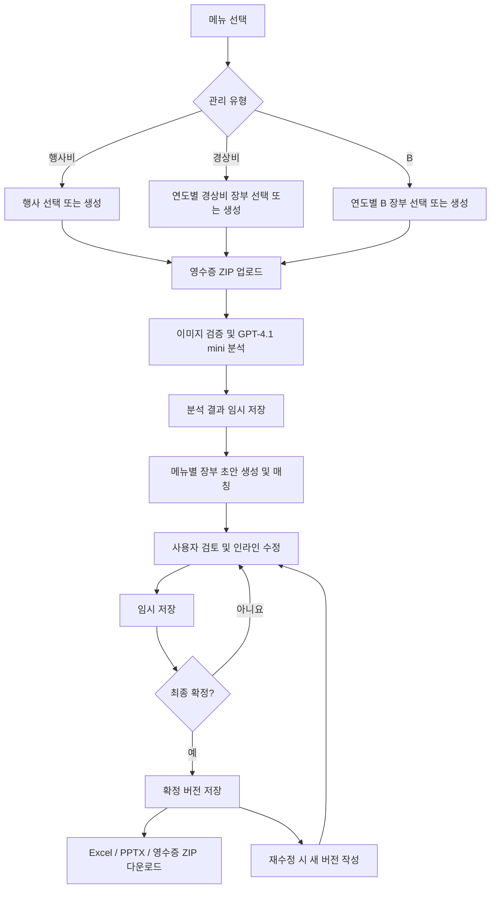

# bpmc_receipt 통합 개발 계획서 v4.0

> 작성일: 2026-11-17  
> 목적: **행사비 / 경상비 / B** 3개 메뉴를 통합하고, 영수증 이미지 AI 분석 → 장부 초안 자동 작성 → 사용자 검토·수정 → 최종 확정 → Excel·PPTX·ZIP 다운로드를 지원한다.  
> **확정 결정:** 경상비와 B는 **연도별 독립 장부**를 생성·관리한다.  
> 기준 자료: 기존 행사비 v3.0 계획서, PPTX 기능 설계서, 사용자가 제공한 경상비 예산표·경상비 장부·B 장부 이미지. 이미지에 표시된 명칭과 열 구조를 우선한다.

---

## 1. 확정 범위 및 업무 원칙

### 1.1 메뉴 구성

| 메뉴 | 관리 단위 | 화면 구성 | 데이터 생성 |
|---|---|---|---|
| **행사비** | 행사 1건별 독립 지출내역서 | 행사 목록 Grid → 상세 팝업(지출내역·영수증·항목) | 행사 생성 후 영수증 분석 |
| **경상비** | **연도별 독립 장부** | 연도 선택 → **예산 현황 / 경상비 장부** 탭 | 연도별 장부 생성 후 거래 누적 |
| **B** | **연도별 독립 장부** | 연도 선택 → B 수입·지출 장부 | 연도별 장부 생성 후 거래 누적 |

공통 서비스: ZIP 업로드, 이미지 직접 분석(GPT-4.1 mini), 결과 검토·수정, 원본 영수증 보관, Excel Import/Export, PPTX 증빙자료 생성, 영수증 ZIP 정리.

### 1.2 확정된 업무 규칙
1. AI가 추출한 정보는 **초안**이다. 사용자가 마지막에 수정한 뒤 **최종 확정**한다.
2. AI 추출값과 사용자 최종값은 별도로 보관하며 재분석이 수정을 덮어쓰지 않는다.
3. **경상비 2026년과 2027년은 다른 장부**다. B도 마찬가지다. 장부별 연도는 유일하다.
4. 경상비의 **예산 현황과 거래 장부는 동일 연도 안에서 연결**된다.
5. 경상비의 `관·항·목`은 연도별 설정 가능하며, 기존 거래가 있는 항목은 안전하게 비활성화/이관한다.
6. B는 예산표나 관·항·목 없이 **날짜·내용·수입·지출·영수증번호**만 관리한다.
7. 행사비는 행사별 항목을 별도로 설정하고, 행사 날짜를 목록 Grid에 표시한다.
8. 영수증은 기본적으로 지출 증빙이다. 수입·이월금·영수증 없는 지출은 수동 등록 가능하다.
9. Excel/PPTX는 **저장된 최종값** 기준으로 생성한다. 미확정 데이터 출력은 미확정 워터마크/경고를 표시하는 옵션으로 분리한다.
10. 공통 영수증 원본은 재사용할 수 있으나 서로 다른 장부에 중복 반영할 때 경고한다.

### 1.3 미확정 업무 정책(구현 전 사용자 확인)
- 경상비 첫 이미지의 **`관` 명칭**, 예산 연도 이월 방식 및 새해 예산 복사 여부
- 경상비 `영수증번호`가 연도별 1부터 시작하는지(기본안: **메뉴+연도별 1부터**)
- B 이월금이 `수입`에 표시되는지와 별도 `이월` 유형 표기 방식(기본안: 화면에는 수입, 집계는 이월 구분)
- 경상비 예산 현황의 **실지출 집계에 미확정 거래를 포함할지**(기본안: 확정분만 공식 집계, 초안 별도 표시)
- 실제 `.xlsx` 파일에 있는 병합 셀, 수식, 체크박스, 데이터 유효성 검사 재현 범위

---

## 2. 전체 사용자 흐름



### 2.1 상태 모델
- `DRAFT` 작성중: AI 초안 생성, 수동 수정 및 임시 저장 가능
- `REVIEW` 검토중: 미연결·불확실 영수증과 금액 차이 확인
- `CONFIRMED` 최종 확정: 확정 시점의 장부 스냅샷 저장, 공식 출력 기준
- `REVISING` 재수정중: 기존 확정 버전을 유지하며 다음 버전 수정
- 재확정 시 버전 번호 증가, 수정자·수정 시각·변경 사유 기록

**저장 규칙:** 자동 작성 직후 초안은 DB에 저장할 수 있지만, `최종 확정` 버튼을 누르기 전에는 확정 장부로 간주하지 않는다. 다운로드는 기본적으로 최신 확정 버전을 사용한다.

---

## 3. 화면/메뉴 UI 설계

### 3.1 공통 네비게이션
```text
┌──────────────────────────────────────────────────────────────────────┐
│ bpmc_receipt                            [검색] [사용자/설정]         │
├──────────────┬───────────────────────────────────────────────────────┤
│ 행사비       │ 선택한 메뉴의 본문                                    │
│ 경상비       │                                                       │
│ B            │                                                       │
└──────────────┴───────────────────────────────────────────────────────┘
```
공통: 검색·필터, 결과 건수, 상태 배지, 수정 경고, 업로드 진행률, Excel/PPTX/ZIP 다운로드. 긴 표는 고정 헤더·가로 스크롤·금액 우측 정렬을 사용한다.

### 3.2 행사비 — 행사 목록 Grid
**컬럼:** `No. | 행사명 | 행사 날짜 | 행사기간 | 지출건수 | 총지출 | 영수증 현황 | 상태 | 관리`

- `행사 날짜`는 행사기간과 구분된 단일 날짜 필드(`event_date`).
- 행사명/날짜/기간/상태로 검색·정렬.
- 행 클릭 → 대형 상세 팝업.
- 행사별 항목(예: 음식/선물, 환대, 시각화, 준비비)은 고정값이 아니라 행사별 설정값.
- 상세 팝업은 이미지 기준 **9개 컬럼**:
  `No. | 지출일 | 항목 | 품목 | 총계 | 구매처 | 영수증 No. | 영수증 총합 | 구매 여부`.
- 상단 총지출, 우측 항목별 총계, 영수증 연결 및 검토 기능.
- Excel 가져오기/내보내기, PPTX/ZIP 다운로드.
- **행사비는 기존 v3.0의 행사별 관리·수정·확정·버전 관리 정책을 유지한다.**

### 3.3 경상비 — 연도별 독립 장부 선택
```text
경상비 관리
[연도 ▼ 2026] [2027년 장부 생성] [전년도 예산 복사(선택)]
[예산 현황] [경상비 장부]

선택: 2026년 경상비
[총예산] [확정 실지출] [잔액] [집행률]
```
- 연도 선택 시 **해당 연도에 속한 예산/거래/영수증만 조회**.
- 미생성 연도는 `장부 생성` 안내. 임의 자동 생성하지 않는다.
- 새 연도 생성 시 예산표 빈 상태 또는 이전 연도 예산 복사 옵션.
- 전년도 거래는 새 연도에 복사하지 않는다. 이월금은 별도 수동/승인 입력.

#### 3.3.1 경상비 예산 현황 탭 (첫 번째 이미지)
**컬럼:** `관 | 항 | 목 | [선택 연도] 예산 | 세부내용 | 실지출 | 잔액 | 비율`

- `관/항/목` 계층 구조를 연도별로 구성.
- `항` 예시: 운영비, 사역비, 양육비, 교육비, 선물비, 행정비.
- `목` 예시: 팀장운영, 레디플레이스, 절기예배, 교재구입 등(이미지 참조, 전부 설정 가능).
- `소계`는 항별로, `합계`는 연도 전체로 표시.
- `실지출`은 동일 연도 경상비 장부의 **확정 지출**을 목별 합산.
- `잔액 = 예산 - 실지출`; `비율 = 실지출 / 예산 × 100` (예산 0이면 `-` 표시).
- 세부내용, 예산, 항목명은 편집 가능. 사용 중인 목 삭제는 차단하고 이관/비활성화 안내.
- 예산 수정 이력과 최종 수정 시각 저장.
- Excel Import/Export: 원본 예산표와 유사한 병합·소계·합계·서식.

#### 3.3.2 경상비 장부 탭 (두 번째 이미지)
**컬럼:** `날짜 | 항 | 목 | 내용 | 수입 | 지출 | 영수증번호`

- 날짜는 DB에 연도 포함 `YYYY-MM-DD`로 저장하고 화면은 `1. 1` 형식 가능.
- 항 선택 시 해당 항에 속한 목만 선택 가능(종속 드롭다운).
- 수입·지출은 원화 정수; 하나의 거래 행에는 한쪽만 금액 입력.
- `1월 경상비`, `2월 경상비` 같은 수입 행은 영수증 없이 수동 입력.
- 영수증 ZIP 분석 시 `날짜/내용/지출` 초안 생성 후 **항/목을 AI 후보 분류**, 사용자가 확정.
- 영수증번호는 연결된 영수증 식별자와 매핑.
- 필터: 연도(필수), 월/기간, 항, 목, 영수증 연결 상태, 확정 상태.
- 합계: 수입합계, 지출합계, 기간 수지 차액. 예산 실지출에는 **지출만** 반영.
- 연도별 장부 Excel Import/Export 지원.

### 3.4 B — 연도별 독립 장부 (세 번째 이미지)
```text
B 장부
[연도 ▼ 2026] [2027년 장부 생성] [기간 01.01 ~ 12.31] [조회]
[총수입] [총지출] [수지차액]
[영수증 ZIP 업로드] [행 추가] [Excel 가져오기] [Excel 내보내기]
[PPTX 다운로드] [영수증 ZIP 다운로드]

날짜 | 내용 | 수입 | 지출 | 영수증번호
```
- **예산 현황, 관·항·목이 없음.**
- 수입·지출·이월금·캐시백 등 거래유형을 내부적으로 구분하되 화면 컬럼은 원본 5개 유지.
- 연도별 신규 장부를 명시적으로 생성.
- 이전 연도 장부와 행·영수증번호를 분리.
- 연초 이월금은 이전 연도 말 잔액을 참고하여 **제안**할 수 있지만 자동 확정 금지.
- 영수증 분석은 기본적으로 `지출` 초안 생성; 수입은 수동 등록/수정 가능.
- 총수입·총지출·수지 차액 표시. 이월금 포함/제외 집계는 명시.
- Excel Import/Export 및 기간별 PPTX 다운로드.

---

## 4. 공통 영수증 AI 분석 설계

### 4.1 기본 분석 방식
- 기본: **GPT-4.1 mini 이미지 직접 분석**(현재 사용 중인 모델).
- 별도 OCR 선행을 필수로 두지 않는다. 필요하면 비용 최적화 옵션으로 로컬 OCR 추가.
- 이미지별 `날짜`, `시간`, `구매처`, `내용/품목`, `최종 결제금액`, `신뢰도/검토 사유` 추출.
- 할인 전 합계와 실제 결제금액을 구분; 추정 불가 값은 `null`.
- `AI 원본 추출값`과 `사용자 최종 수정값` 별도 저장.
- 행사별 카테고리 또는 경상비 연도별 항·목 목록을 분석 컨텍스트로 전달하여 **분류 후보** 제안.
- B는 분류 없이 거래 내역과 금액만 반영.

### 4.2 업로드/처리 단계
1. 메뉴·대상 행사 또는 연도별 장부 선택.
2. JPG/PNG/WEBP 또는 해당 파일이 포함된 ZIP 업로드.
3. ZIP 경로 조작, 압축 폭탄, 이미지 크기·파일 수·형식 검증.
4. SHA-256 해시로 중복 후보 탐지.
5. 이미지 분석 작업 생성 → 진행률 및 성공/실패 표시.
6. 구조화 JSON 파싱·날짜/금액 타입 검증.
7. 기존 장부 행 매칭 후보 제시 또는 신규 행 초안 생성.
8. 원본 이미지와 분석값을 나란히 보여주고 사용자가 수정.
9. 임시 저장 → 검토중 → 최종 확정.
10. 확정된 데이터를 Excel/PPTX/ZIP에 사용.

### 4.3 AI 결과 예시
```json
{
  "transaction_date": "2026-02-07",
  "transaction_time": "13:42:00",
  "merchant": "예시 매장",
  "description": "팀장모임 커피",
  "final_amount_krw": 30700,
  "suggested_category_id": null,
  "suggested_budget_item_id": 101,
  "needs_review": false,
  "review_reason": null
}
```
모델 응답은 JSON Schema로 검증하고, 누락값·충돌·취소/환불 영수증은 검토 대상으로 둔다. LLM이 자동으로 최종 확정하지 않는다.

### 4.4 영수증 매칭
- 한 영수증이 여러 장부 행에 대응하거나 한 장부 행에 여러 영수증이 연결될 수 있도록 연결 테이블 사용.
- 한 영수증을 서로 다른 메뉴/연도/행사에 재사용하려면 경고 후 사용자 승인.
- 영수증 고유 ID와 화면에 보이는 번호를 분리.
- 날짜 수정 후 정렬 순서가 바뀌어도 영수증 연결은 유지.

---

## 5. Excel 기능 설계

### 5.1 공통 Import
- `.xlsx` 파일 업로드 → 시트/헤더 인식 → 컬럼 매핑 → 미리보기 → 오류 확인 → 반영.
- `추가` 또는 `기존 데이터 대체` 선택. 대체는 백업/확인/트랜잭션 필수.
- 수식 캐시가 없거나 날짜 연도가 불명확하면 사용자 확인.
- 원본의 병합 셀, 빈 날짜 반복, 원화 서식, 합계행 등을 처리.
- 다른 연도 날짜가 포함된 행은 경고하고 자동으로 다른 장부에 섞지 않는다.
- 행 중복 후보 표시.

### 5.2 메뉴별 Excel Export
| 메뉴 | 시트/양식 | 출력 범위 |
|---|---|---|
| 행사비 | `지출내역(구매LIST)` 9개 컬럼 + 항목별 총계 | 행사별 |
| 경상비 | `예산 현황`(관·항·목·예산·실지출·잔액·비율), `경상비 장부`(7개 컬럼) | 선택 연도 |
| B | `B 장부`(날짜·내용·수입·지출·영수증번호) + 우측 수입/지출 요약 | 선택 연도/기간 |

- `openpyxl` 사용; 헤더색·테두리·원화·소계/합계·드롭다운·인쇄 영역 설정.
- 실제 원본 `.xlsx`를 확보하면 병합·수식·체크박스 표현을 추가 분석하여 서식 정밀도를 높인다.
- Excel 재업로드 왕복 테스트로 필드 유실 방지.
- **경상비 예산표의 실지출은 장부에서 자동 산출**하므로 Import 충돌 시 장부 합계를 우선하고 차이를 표시.

---

## 6. PPTX 영수증 증빙 자동 생성

### 6.1 공통 규칙
- `python-pptx` + Pillow.
- 슬라이드: 16:9 와이드, **슬라이드당 영수증 3장**.
- 원본 비율 유지(자르기/늘리기 금지); 이미지 영역 내 중앙 배치.
- 이미지 아래: `영수증 번호 / 거래 날짜·시간 / 구매처 / 최종금액`.
- 행사명 또는 `경상비 2026년`, `B 2026년` 제목 및 페이지 번호 표시.
- 최종 저장된 데이터 사용, 별도 AI 재호출 없음.
- 20장 → **7슬라이드**, 마지막 2장은 균형 있게 배치.
- 이미지 손상/누락 시 조용히 제외하지 않고 사용자에게 오류 표시.
- 영수증번호는 장부 참조 번호와 일치시키고, PPT 표시 순서는 거래일시순.
- 날짜/시간 누락 영수증은 검토 목록에 두고 사용자가 포함 여부/순서를 결정.
- 원본이 매우 긴 영수증은 읽기 어려울 수 있으므로 **1장 확대 레이아웃 선택 옵션**을 추후 추가.

### 6.2 메뉴별 생성 범위
| 메뉴 | 기본 범위 | 파일명 예시 |
|---|---|---|
| 행사비 | 선택 행사 전체 | `11월행사_영수증증빙자료.pptx` |
| 경상비 | 선택 연도 + 조회 기간 | `경상비_2026_01월_영수증증빙자료.pptx` |
| B | 선택 연도 + 조회 기간 | `B_2026_01월_영수증증빙자료.pptx` |

**연도 독립성:** 경상비 2026년 PPT에는 2027년 영수증이 들어가지 않는다. B도 동일.

### 6.3 API
```http
GET /api/events/{event_id}/receipts/export-pptx?per_slide=3
GET /api/ordinary/books/{book_id}/receipts/export-pptx?from=2026-01-01&to=2026-12-31&per_slide=3
GET /api/b/books/{book_id}/receipts/export-pptx?from=2026-01-01&to=2026-12-31&per_slide=3
```
응답: `application/vnd.openxmlformats-officedocument.presentationml.presentation`, 다운로드 파일명은 `Content-Disposition`으로 지정.

### 6.4 영수증 ZIP
- 거래일시 오름차순, `1_5000.jpg`, `2_7500.png` 등 번호/금액으로 이름 변경.
- 원본 확장자 유지, 파일 바이트는 가능한 그대로 사용.
- 확정값으로 정렬/금액 표시.
- 미분류·날짜 누락은 검토 대상 별도 폴더로 분리.
- 선택 행사 또는 연도별 장부의 조회 기간으로 범위 제한.

---

## 7. 데이터베이스 설계

권장: 초기 SQLite + SQLAlchemy/Alembic, 다중 사용자 확장 시 MariaDB/PostgreSQL 전환 가능.

### 7.1 핵심 테이블
| 테이블 | 주요 컬럼 | 설명 |
|---|---|---|
| `events` | id, name, event_date, start_date, end_date, status | 행사비 행사 |
| `event_categories` | id, event_id, name, color, sort_order, active | 행사별 항목 |
| `event_expenses` | id, event_id, category_id, expense_date, item_name, amount_krw, vendor, purchased | 행사 지출 |
| `ordinary_books` | id, year UNIQUE, status, version | **경상비 연도별 독립 장부** |
| `ordinary_budget_items` | id, book_id, parent_id, level, name, budget_krw, detail, sort_order, active | 관·항·목 예산 트리 |
| `ordinary_entries` | id, book_id, transaction_date, budget_item_id, description, income_krw, expense_krw, entry_type, status | 경상비 거래 |
| `b_books` | id, year UNIQUE, status, version | **B 연도별 독립 장부** |
| `b_entries` | id, book_id, transaction_date, description, income_krw, expense_krw, entry_type, status | B 거래 |
| `receipts` | id, storage_key, sha256, original_name, ai_result_json, final_result_json, analysis_status | 공통 영수증 |
| `receipt_links` | id, receipt_id, target_type, target_id, allocated_amount_krw, receipt_number | 영수증↔장부 행 연결 |
| `analysis_jobs` | id, scope_type, scope_id, status, progress, tokens_in, tokens_out, cost_usd | AI 작업/비용 |
| `book_versions` | id, scope_type, scope_id, version, snapshot_json, confirmed_at, reason | 확정 스냅샷 |
| `audit_logs` | id, entity_type, entity_id, action, before_json, after_json, created_at | 변경 이력 |

**구현 주의:** `receipt_links`의 다형성 참조(`target_type/target_id`)는 DB FK로 직접 강제하기 어렵다. 서비스 검증 및 DB 무결성 전략을 명시하거나 메뉴별 연결 테이블로 분리한다.

### 7.2 제약 및 집계
- `ordinary_books.year` UNIQUE, `b_books.year` UNIQUE.
- 거래일의 연도는 연결된 장부 연도와 일치해야 함. 예외적인 전년도 거래는 해당 연도 장부에 입력하도록 안내.
- `ordinary_entries.budget_item_id`는 같은 `book_id`에 속한 **목 레벨**만 참조.
- 수입/지출은 한 행에서 동시에 양수 불가; 금액은 원화 정수.
- 공식 경상비 실지출 = `SUM(ordinary_entries.expense_krw WHERE status=CONFIRMED)`를 예산 목별 합산.
- 경상비 잔액 = 예산 − 실지출, 집행률 = 실지출 / 예산 × 100.
- B 총수입/총지출은 확정 행 기준; 이월금은 별도 집계 옵션.
- 버전 스냅샷은 장부·예산·영수증 링크 상태를 재현할 수 있어야 함.
- 새 연도 생성 시 **기존 연도 데이터는 변경하지 않는다**.

### 7.3 연도 생성 시나리오
```text
경상비 → [2027년 장부 생성]
  ├─ 2027년 장부 레코드 생성
  ├─ 예산 항목: 빈 템플릿 / 2026년 예산 복사(사용자 선택)
  ├─ 거래: 빈 목록
  └─ 영수증 번호: 1부터 새로 시작

B → [2027년 장부 생성]
  ├─ 2027년 장부 레코드 생성
  ├─ 거래: 빈 목록
  ├─ 이월금: 전년도 잔액 참고값만 제안
  └─ 영수증 번호: 1부터 새로 시작
```

---

## 8. API 설계

### 8.1 행사비 (기존 기능 유지)
- `GET/POST /api/events`
- `GET/PATCH/DELETE /api/events/{id}`
- `GET/POST /api/events/{id}/expenses`
- `PATCH/DELETE /api/event-expenses/{id}`
- `GET/POST/PATCH /api/events/{id}/categories...`
- `POST /api/events/{id}/excel/import/preview`
- `POST /api/events/{id}/excel/import/commit`
- `GET /api/events/{id}/excel/export`
- `GET /api/events/{id}/receipts/export-pptx`
- `GET /api/events/{id}/receipts/export-zip`

### 8.2 경상비
| Method | Endpoint | 기능 |
|---|---|---|
| GET | `/api/ordinary/books` | 생성된 연도별 장부 목록 |
| POST | `/api/ordinary/books` | 연도별 장부 생성 |
| GET | `/api/ordinary/books/{id}` | 장부 메타/집계 |
| GET/PUT | `/api/ordinary/books/{id}/budget` | 관·항·목 및 예산 조회/수정 |
| GET/POST | `/api/ordinary/books/{id}/entries` | 장부 거래 조회/추가 |
| PATCH/DELETE | `/api/ordinary/entries/{id}` | 거래 수정/삭제 |
| POST | `/api/ordinary/books/{id}/excel/import/preview` | Excel 미리보기 |
| POST | `/api/ordinary/books/{id}/excel/import/commit` | Excel 반영 |
| GET | `/api/ordinary/books/{id}/excel/export` | 예산+장부 Excel |
| GET | `/api/ordinary/books/{id}/receipts/export-pptx` | PPTX |
| GET | `/api/ordinary/books/{id}/receipts/export-zip` | ZIP |

### 8.3 B
| Method | Endpoint | 기능 |
|---|---|---|
| GET | `/api/b/books` | 연도별 장부 목록 |
| POST | `/api/b/books` | 장부 생성 |
| GET | `/api/b/books/{id}` | 장부 메타/집계 |
| GET/POST | `/api/b/books/{id}/entries` | 거래 조회/추가 |
| PATCH/DELETE | `/api/b/entries/{id}` | 거래 수정/삭제 |
| POST | `/api/b/books/{id}/excel/import/preview` | Excel 미리보기 |
| POST | `/api/b/books/{id}/excel/import/commit` | Excel 반영 |
| GET | `/api/b/books/{id}/excel/export` | Excel |
| GET | `/api/b/books/{id}/receipts/export-pptx` | PPTX |
| GET | `/api/b/books/{id}/receipts/export-zip` | ZIP |

### 8.4 공통
- `POST /api/receipts/upload` — 대상 `scope_type` + `scope_id` 지정.
- `POST /api/analysis-jobs` — AI 이미지 분석 작업 시작.
- `GET /api/analysis-jobs/{id}` — 진행률·오류·토큰·비용.
- `PATCH /api/receipts/{id}` — 사용자 분석값 수정.
- `POST /api/receipt-links` — 영수증 연결/매칭.
- `POST /api/scopes/{type}/{id}/confirm` — 확정 버전 생성(라우팅은 구현 시 정리).
- `POST /api/scopes/{type}/{id}/revise` — 재수정 시작.
- Import는 미리보기와 확정을 분리하고, 데이터 반영은 트랜잭션으로 처리.
- 모든 API는 연도/행사 범위 검증을 필수로 수행.

---

## 9. 권장 기술 스택 및 코드 구조

| 영역 | 기술 |
|---|---|
| Frontend | Next.js + TypeScript + Tailwind |
| Grid | TanStack Table 또는 AG Grid Community |
| Backend | FastAPI + Python |
| DB | SQLite + SQLAlchemy + Alembic |
| 이미지 분석 | OpenAI GPT-4.1 mini (비전 입력) |
| Excel | openpyxl |
| PPTX | python-pptx + Pillow |
| ZIP | zipfile |
| 테스트 | pytest + Playwright |
| 실행 | 로컬 우선, 필요시 Docker Compose |

```text
bpmc_receipt/
├── frontend/
│   ├── app/
│   │   ├── events/
│   │   ├── ordinary/
│   │   └── b/
│   ├── components/
│   │   ├── EventGrid.tsx
│   │   ├── EventExpenseModal.tsx
│   │   ├── OrdinaryBudgetGrid.tsx
│   │   ├── OrdinaryLedgerGrid.tsx
│   │   ├── BLedgerGrid.tsx
│   │   ├── ReceiptReviewPanel.tsx
│   │   └── ExportActions.tsx
│   └── lib/api.ts
├── backend/
│   ├── app/
│   │   ├── api/            # events, ordinary, b, receipts, exports
│   │   ├── models/         # SQLAlchemy
│   │   ├── schemas/        # Pydantic
│   │   └── services/
│   │       ├── receipt_analyzer.py
│   │       ├── receipt_matcher.py
│   │       ├── budget_aggregator.py
│   │       ├── excel_importer.py
│   │       ├── excel_exporter.py
│   │       ├── ppt_generator.py
│   │       ├── receipt_zip_exporter.py
│   │       └── version_service.py
│   ├── alembic/
│   └── tests/
├── storage/                # Git 제외
├── .env.example
└── README.md
```

---

## 10. 보안·비용·성능

- API 키는 `.env`/서버 환경변수에 저장하고 Git에 커밋하지 않음.
- 이미지·OCR/AI 결과에는 카드번호, 연락처 등 민감정보가 포함될 수 있으므로 전송·보관 최소화.
- ZIP Slip, 압축 폭탄, 허용 이미지 확장자·용량·장수 제한.
- AI 재시도 횟수 및 월간 비용 모니터링.
- 현재 가정: 1명, 월 4회 × 약 50장 = 월 200장. 모델 비용은 실제 입력/출력 토큰·가격·재시도에 따라 계산.
- 크레딧이 있더라도 만료일·자동 충전 설정은 별도 확인.
- 연도별 장부 데이터와 파일 저장 경로를 분리해 다른 연도 혼입 방지.
- 파일/DB 정기 백업 및 복구 절차 마련.
- 50장 일괄 분석은 작업 ID 기반 비동기 처리와 진행률 UI 권장.
- PPT/Excel 생성은 저장된 데이터로만 수행하므로 AI 재호출 비용 없음.

---

## 11. 단계별 개발 일정

**전제:** 기존 행사비 기능과 영수증 분석/저장 일부가 구현되어 있으며, 1명 개발 기준. 기존 코드 품질·실제 Excel 파일 확보 여부에 따라 변경 가능.

| 단계 | 작업 | 예상 기간 |
|---|---|---:|
| 0 | 기존 코드 점검, 원본 Excel 확보, 업무 규칙 확정 | 1~2일 |
| 1 | 공통 영수증·버전 관리·연도별 장부 DB 확장 | 2~4일 |
| 2 | 경상비 연도 생성·예산 현황 UI·집계 | 3~5일 |
| 3 | 경상비 연속 거래 Grid 및 항·목 연동 | 3~5일 |
| 4 | B 연도 생성·수입/지출 Grid·이월 처리 | 2~4일 |
| 5 | 공통 AI 분석→메뉴별 초안 반영·최종 확정 | 2~4일 |
| 6 | 메뉴별 Excel Import/Export | 3~5일 |
| 7 | 행사비·경상비·B PPTX/ZIP 다운로드 통합 | 1~3일 |
| 8 | E2E 테스트·보안·성능·배포 | 2~4일 |
| **합계** | **추가 개발 예상** | **19~36 개발일** |

### 구현 우선순위
1. **P1** 경상비·B 연도별 장부 생성, 수동 입력·조회·수정·저장.
2. **P1** 경상비 예산 현황과 거래 집계 연결.
3. **P1** 공통 영수증 AI 분석 및 메뉴별 초안 자동 생성.
4. **P1** 최종 검토·수정·확정·버전 보존.
5. **P1** Excel Import/Export, PPTX/ZIP 다운로드.
6. **P2** 이전 연도 예산 복사, 이월금 제안, 고급 필터/통계.

---

## 12. 검수/인수 테스트 (Definition of Done)

### 행사비
- [ ] 행사 목록 Grid에 `행사 날짜`가 표시되고 검색·정렬된다.
- [ ] 행 클릭 시 9개 컬럼 상세 팝업이 열린다.
- [ ] 행사별 항목 추가/변경이 다른 행사에 영향을 주지 않는다.
- [ ] 영수증 AI 초안 → 수정 → 확정 → Excel/PPTX/ZIP 다운로드 가능.

### 경상비
- [ ] 2026년/2027년 장부를 **별도로 생성**할 수 있다.
- [ ] 2026년 예산·거래 수정이 2027년에 반영되지 않는다.
- [ ] 관·항·목을 연도별로 관리할 수 있다.
- [ ] 거래를 목에 연결하면 해당 예산의 실지출/잔액/비율이 정확히 계산된다.
- [ ] 수입·지출·영수증 없는 행도 수동 등록 가능.
- [ ] Excel Import/Export가 7개 컬럼 및 예산표 구조를 유지한다.
- [ ] 선택 연도·기간의 영수증만 PPTX/ZIP에 포함된다.

### B
- [ ] 2026년/2027년 장부가 독립되어 조회·수정·저장된다.
- [ ] `날짜 | 내용 | 수입 | 지출 | 영수증번호` 5개 컬럼 유지.
- [ ] 이월금과 일반 수입을 구분하여 집계할 수 있다.
- [ ] 영수증 분석 결과로 지출 초안 생성 후 사용자 수정·확정 가능.
- [ ] Excel/PPTX/ZIP 다운로드 시 선택 연도 데이터만 포함된다.

### 공통
- [ ] 20장 영수증으로 PPTX 생성 시 **7슬라이드**, 각 슬라이드 최대 3장.
- [ ] 이미지가 잘리거나 왜곡되지 않고 번호·날짜·시간·구매처·금액이 표시된다.
- [ ] 확정 이후 재수정해도 이전 확정 버전을 복구·조회할 수 있다.
- [ ] 분석 오류·이미지 누락·날짜 미확인·중복 영수증을 사용자에게 표시한다.
- [ ] 외부 API 호출 토큰·추정 비용을 작업별로 조회할 수 있다.
- [ ] ZIP·Excel 업로드 검증, 백업 및 오류 복구가 동작한다.

---

## 13. 최종 개발 원칙 요약

**행사비는 행사별**, **경상비는 연도별 예산+장부**, **B는 연도별 수입·지출 장부**로 관리한다. 세 메뉴는 영수증 이미지 분석과 Excel/PPTX/ZIP 출력을 공통 서비스로 재사용한다. AI가 자동으로 장부 초안을 작성하지만 **사용자의 수정과 최종 확정이 반드시 마지막 단계**다. 경상비와 B의 새 연도 장부는 명시적으로 생성하며 **서로 다른 연도의 데이터는 독립적으로 보존**한다.
