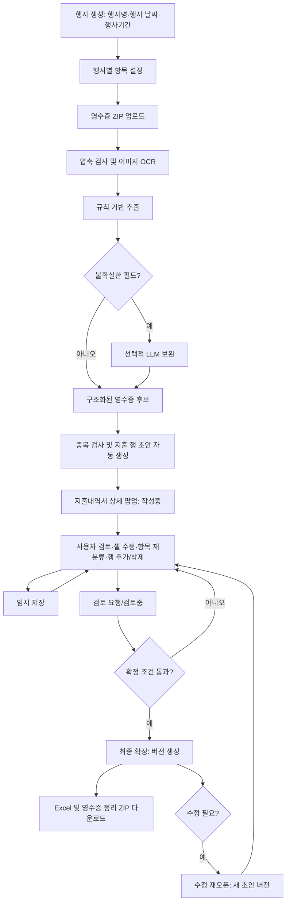

# 행사별 지출내역 및 영수증 자동작성 시스템 — 개발 계획서 v3.0

> 작성일: 2026-11-17  
> 기준: 기존 v2.1 계획서 및 제공된 「지출내역(구매LIST)」 화면  
> **핵심 원칙: 영수증 이미지가 지출내역서의 기본 입력원이며, 사용자가 검토·수정한 뒤 최종 확정한다.**  
> 규모: 초기 사용자 1명, 월 4회 × 회당 약 50장(월 약 200장)

## 1. 이번 설계에서 확정한 방향

기존 설계는 Excel·수기 입력과 OCR 입력이 병렬이었고, 자동작성·임시저장·확정의 경계가 불명확했다. v3.0에서는 **영수증 ZIP → OCR/선택적 LLM → 지출내역서 초안 자동 생성 → 사용자 수정 → 최종 확정 저장**을 주 경로로 정한다. Excel Import와 직접 행 입력은 보조 경로다.

- **자동 분석 결과는 최종 데이터가 아니다.** OCR 원본·추출 후보·사용자 최종 수정값을 구분 저장한다.
- AI가 만든 지출 행은 **초안**이며, 사용자 승인 없이 확정되지 않는다.
- 자동 추출 실패/모호성/중복은 검토 대상으로 남긴다. 임의 날짜·금액을 만들어 채우지 않는다.
- 사용자는 지출일·항목·품목·총계·구매처·영수증 No.·영수증 총합·구매 여부를 수정할 수 있다. 단, 영수증 연결에서 자동 계산되는 값은 직접 덮어쓰기보다 **연결/배분 수정**을 우선 제공한다.
- 행사마다 항목 구성이 다르며 변경 가능하다.
- Excel Export는 **최종 확정 버전**을 기본으로 한다. 작성중/검토중 상태에서는 '초안' 워터마크 또는 파일명 표시 후 별도 내보내기 가능.
- **임시저장과 최종 확정은 별도 동작**이며, 확정 후 수정은 재오픈 및 재확정 과정을 거친다.

## 2. 핵심 업무 흐름



### 2.1 주요 시나리오

1. 사용자가 행사 A를 생성하고 행사 날짜를 입력한다.
2. 항목 기본값 `음식/선물`, `환대`, `시각화`, `준비비`를 필요에 맞게 변경한다.
3. 영수증 50장이 담긴 ZIP을 업로드한다.
4. 시스템은 OCR 결과를 이용해 지출일, 거래시간, 품목/내역, 결제금액, 구매처를 추출한다.
5. 기존 지출 행과 유사한 영수증은 **중복 신규 행 생성 없이 매칭 후보**로 제안한다. 그 외에는 초안 행을 생성한다.
6. 상세 팝업에서 사용자가 모든 행을 검토한다. 예를 들어 품목명을 수정하고 `환대`로 항목을 변경한다.
7. **임시 저장**하면 수정값은 DB에 유지되지만 아직 최종본은 아니다.
8. **최종 확정**하면 필수값·검토 상태·금액 차이를 검사하고 확정본 스냅샷을 저장한다.
9. 확정본 기준으로 Excel 및 거래일시순 영수증 ZIP을 다운로드한다.

### 2.2 예외 시나리오

- 영수증의 시간만 없는 경우: 날짜만 추출하고 시간은 비워둔다. 사용자 확인 후 정렬 규칙을 적용한다.
- 하나의 영수증에 여러 품목이 있는 경우: MVP 기본값은 **영수증 1장 → 지출 행 1개(요약 품목)**. 사용자가 행을 분할할 수 있다.
- 하나의 지출 행에 영수증 여러 장이 있는 경우: 복수 연결 가능.
- 기존 Excel 행과 영수증이 일치하는 경우: 새 행을 중복 생성하지 않고 기존 행 연결을 제안한다.
- 취소/환불 전표: 자동 확정 금지, 사용자에게 별도 상태로 표시.
- 영수증이 없는 지출: 수기 추가 허용, '영수증 없음' 사유 표시.
- 같은 ZIP 재업로드: SHA-256 기반 중복 검사 후 건너뛰기/재분석 선택.

## 3. 상태·저장·확정 정책 (중요)

| 상태 | 의미 | 수정 | Excel | 전이 |
|---|---|---|---|---|
| 작성중 (`DRAFT`) | AI 자동 생성 직후, 사용자 편집 가능 | 가능 | 초안 표시 후 가능 | 검토중 |
| 검토중 (`REVIEW`) | 사용자 확인 및 오류 수정 중 | 가능 | 초안 표시 후 가능 | 작성중 또는 최종 확정 |
| 최종 확정 (`FINAL`) | 확정 스냅샷 생성 및 잠금 | 직접 수정 불가 | **확정본 다운로드** | 수정 재오픈 |
| 재수정중 (`REVISION`) | 확정본에서 새 편집 버전 분기 | 가능 | 직전 확정본 유지 | 재확정 |

**임시 저장:** 현재 편집값과 행/항목/영수증 연결을 DB에 저장한다. 초안 버전만 변경하며 `FINAL`로 바뀌지 않는다. 화면 이탈 시 미저장 변경을 경고한다.

**최종 확정:** (1) 필수값 확인 (2) 미해결 검토건 표시 (3) 지출 합계/항목별 합계 재계산 (4) 경고에 대한 승인 또는 수정 (5) DB 트랜잭션으로 **불변 확정 스냅샷** 저장 (6) 행사 상태 `FINAL`로 변경. 금액 불일치·영수증 미첨부는 업무상 허용할 수 있으므로 기본적으로 **사유 확인 후 확정 가능**, 날짜·금액 등 필수값 누락은 차단한다.

**확정 후 수정:** `수정 재오픈` 시 기존 확정본을 덮어쓰지 않고 `REVISION` 초안을 만든다. 재확정 시 v2 확정본을 생성하고 이전 v1도 조회/다운로드할 수 있게 한다. 재확정 이전에는 목록 기본 총지출은 **최신 확정본 기준**으로 표시하고, 재수정중 배지를 추가한다.

**AI 값과 사용자 값:** `ocr_raw_text`, `ai_extracted_json`, `final_expense_fields`, `edited_by`, `edited_at`를 분리한다. 수동 수정은 재분석이 일어나도 자동 덮어쓰지 않는다. 재분석 결과는 차이 비교 후 적용한다.

## 4. UI 설계

### 4.1 행사 목록 Grid

```text
┌─────────────────────────────────────────────────────────────────────────────────────────────────────────────┐
│ 행사별 지출 관리                                            [+ 행사 생성] [Excel로 행사 생성]                │
│ 행사명 [검색]  행사 날짜 [시작~종료]  행사기간 [시작~종료]  상태 [전체]  [조회] [초기화]                 │
├────┬─────────────┬────────────┬─────────────────────┬──────┬──────────────┬────────────┬────────────┬──────┤
│ No │ 행사명      │ 행사 날짜  │ 행사기간            │ 건수 │ 총지출       │ 영수증 현황│ 상태       │ 상세 │
├────┼─────────────┼────────────┼─────────────────────┼──────┼──────────────┼────────────┼────────────┼──────┤
│ 1  │ 11월 행사 A │ 2026.11.15 │ 2026.11.08~11.15   │ 23   │ ₩3,021,420   │ 18/23 연결 │ 작성중     │ 열기 │
│ 2  │ 12월 행사 B │ 2026.12.03 │ 2026.12.01~12.03   │  8   │ ₩456,000     │  6/8 연결  │ 최종 확정  │ 열기 │
└────┴─────────────┴────────────┴─────────────────────┴──────┴──────────────┴────────────┴────────────┴──────┘
```

- **행사 날짜**는 행사 당일, **행사기간**은 준비/지출 관리 기간으로 별도 저장한다.
- 열 클릭 정렬: 행사 날짜, 행사명, 총지출, 상태.
- 행 클릭: 해당 행사 상세 팝업.
- 총지출은 작성중에는 현재 저장된 초안, 확정 상태에서는 최신 확정본 기준. 재수정중에는 확정본 금액과 편집 중 금액을 구분 표시.
- 영수증 현황은 `영수증 연결 지출 행 수 / 전체 지출 행 수`로 정의.

### 4.2 상세 팝업 (기준 이미지와 동일한 9개 컬럼)

PC: 폭 92~96vw, 높이 90vh, 헤더·하단 액션 고정, 본문 스크롤. 모바일: 전체 화면.

```text
┌──────────────────────────────────────────────────────────────────────────────────────────────────────┐
│ 지출내역(구매LIST) — 11월 행사 A        [작성중]    총지출 ₩3,021,420                 [X]      │
│ 행사 날짜 2026.11.15 | 행사기간 11.08~11.15 | 최종 확정 버전: 없음                             │
├──────────────────────────────────────────────────────────────────────────────────────────────────────┤
│ [지출내역] [영수증 분석/매칭] [항목 관리] [변경 이력]                                              │
│ [+ 행 추가] [행 삭제] [Excel Import] [Excel Export] [영수증 ZIP 업로드]                              │
│                                                                                                      │
│ No. | 지출일 | 항목▼ | 품목             | 총계       | 구매처 | 영수증 No. | 영수증 총합 | 구매 여부│
│  1  | 11.08  | 음식/선물 | 옛날간식       | ₩100,700   | 쿠팡   | 1           | ₩100,700   | ☑       │
│  2  | 11.09  | 환대      | 점심식사       | ₩15,100    | 네이버 | 2           | ₩15,100    | ☑       │
│ ...                                                                                                  │
│                                                                                                      │
│ 항목별 총계: 음식/선물 ₩1,713,350 | 환대 ₩519,500 | 시각화 ₩366,070 | 준비비 ₩422,500            │
├──────────────────────────────────────────────────────────────────────────────────────────────────────┤
│ 영수증 검토 필요 2건 | 미연결 3건 | 미저장 변경 1건     [임시 저장] [검토중으로 전환] [최종 확정] │
└──────────────────────────────────────────────────────────────────────────────────────────────────────┘
```

**컬럼 정의**

| 순서 | 컬럼 | 데이터 원천 | 사용자 수정 | 규칙 |
|---|---|---|---|---|
| 1 | No. | 정렬 결과 | 직접 불가 | 자동 순번 |
| 2 | 지출일 | OCR 거래일 | 가능 | 행사 연도 포함해 DB 저장 |
| 3 | 항목 | 자동 분류 후보 | 가능 | 행사별 항목 드롭다운 |
| 4 | 품목 | OCR 구매내역 | 가능 | 자유 텍스트 |
| 5 | 총계 | OCR 최종 결제금액 | 가능 | KRW 정수, 원화 서식 |
| 6 | 구매처 | OCR 상호명 | 가능 | 자유 텍스트 |
| 7 | 영수증 No. | 연결 영수증 | 연결 수정 | 복수 영수증 가능 |
| 8 | 영수증 총합 | 연결 금액 합계 | 배분액 수정 | 중복 집계 방지 |
| 9 | 구매 여부 | 기본 미확인 | 가능 | 체크박스 |

**행 클릭:** 오른쪽 미리보기 패널에 연결 영수증 원본과 OCR 값, 현재 수정값 비교 표시. **셀 편집:** 즉시 화면 합계 갱신, `임시 저장` 시 DB 반영. **행 삭제:** 확인 후 소프트 삭제 또는 변경 이력 기록. **영수증 연결:** 선택 모달에서 여러 장 연결/해제 및 배분액 조정.

### 4.3 영수증 분석/매칭 탭

- 업로드 → 분석 진행률(완료/실패/검토 필요) → 추출 결과 테이블
- 필드: 원본 파일명, 거래일시, 상호, 내역, 최종금액, OCR 신뢰/상태, 매칭된 지출 행
- 오른쪽 이미지 미리보기 및 OCR 원문/수정값 비교
- `[선택 항목을 초안 행으로 반영]`, `[기존 지출에 연결]`, `[중복 제외]`
- 기본 정책: 업로드 후 분석이 완료되면 **중복이 아닌 영수증은 초안 행으로 자동 생성**. 검토가 필요한 항목도 표시하되 미확인 값은 비워둔다.
- 이미 수동 수정한 행은 재업로드/재분석으로 덮어쓰지 않는다.

### 4.4 행사별 항목 관리 탭

- 기본 템플릿 예시: `음식/선물`, `환대`, `시각화`, `준비비`.
- 행사별 추가/이름 변경/순서/색상/비활성화/다른 행사에서 복사.
- 기존 지출에서 사용 중인 항목은 삭제 대신 비활성화 또는 다른 항목으로 일괄 이동.
- 카테고리는 이름 문자열이 아니라 `category_id`로 연결.
- Excel 내보내기 항목 드롭다운과 항목별 합계는 해당 행사의 항목을 동적으로 반영.

### 4.5 최종 확정 다이얼로그

```text
최종 확정 전 확인
- 지출 행: 23건
- 총지출: ₩3,021,420
- 필수값 누락: 0건
- 영수증 미연결: 3건 (사유 확인 필요)
- 금액 차이: 1건 (사유 확인 필요)
[돌아가서 수정] [사유 확인 후 확정]
```

확정 완료 시 확정자·시각·버전 번호를 보여주고 Excel/ZIP 다운로드 제공.

## 5. Excel Import / Export

### Import

- 기존 이미지와 같은 「지출내역(구매LIST)」 `.xlsx` 지원을 우선 구현.
- 제목/헤더/총계 행을 판별해 **No., 지출일, 항목, 품목, 총계, 구매처, 영수증 No., 영수증 총합, 구매 여부**를 매핑.
- 미리보기 → 열 매핑/오류 검토 → 신규 행 추가 또는 기존 행과 병합/대체 선택 → 반영.
- 행사에 없는 항목은 새 항목 생성/기존 항목에 매핑/제외 선택.
- Excel 데이터는 **초안으로 가져오며 자동 최종 확정하지 않는다.**
- 영수증에서 자동 생성된 행과 Excel 가져온 행이 겹치면 날짜·품목·금액·구매처 기반 중복 경고.
- 병합 셀, 빈 날짜, 수식 캐시, 체크박스 표현을 검사. 원본 `.xlsx` 확보 후 정확한 매핑 확정.

### Export

- 기본값: **최신 최종 확정 스냅샷**을 Excel로 출력.
- 미확정 행사를 내보낼 때는 `DRAFT_행사명.xlsx`로 구분.
- 제공 이미지와 유사한 연녹색 제목/총지출, 9개 컬럼, 항목별 총계 표, 원화 서식, 테두리, 항목별 색상.
- 항목 목록을 참조하는 Excel 드롭다운 유효성 검사 설정.
- Excel 실제 체크박스 컨트롤은 환경별 호환성 차이가 있으므로 기본은 체크 표시/TRUE·FALSE 셀로 내보낸다.
- `영수증목록` 보조 시트에 영수증 파일명, 분석값, 매칭 행, 상태를 포함할 수 있다.
- Export → Import 왕복 시 금액·항목·날짜가 유지되는지 테스트.

## 6. 영수증 ZIP 처리 및 파일명

```text
입력: receipts.zip (무작위 이미지 50장)
→ ZIP 안전 검사(압축 폭탄, 경로 탐색, 파일 수/크기 제한)
→ OCR 및 필요 시 LLM
→ 사용자 검토 및 수정
→ 최종 확정
→ 영수증 거래일시 오름차순 정렬
→ receipts_sorted.zip
   ├── receipts/
   │   ├── 1_5000.jpg
   │   ├── 2_7500.png
   │   └── 3_12500.jpg
   ├── review_required/ (미확인 영수증이 남는 경우)
   └── receipts_summary.csv
```

- 정렬은 거래일 → 거래시간 → 동일 일시일 경우 원본 파일명 순.
- 거래시간이 없으면 임의 시간을 생성하지 않는다. 사용자 확인 전에는 검토 폴더로 분리.
- 원본 이미지 바이트 유지, 이름만 변경. 서로 다른 확장자 보존.
- 영수증 ZIP의 순번과 지출내역서 No.는 별개.
- 확정본 ZIP을 재현할 수 있도록 **확정 시점의 영수증 연결·수정 메타데이터를 버전과 함께 기록**.

## 7. DB 설계

초기 1인 사용을 고려해 SQLite + SQLAlchemy + Alembic. 다중 사용자 확장 시 PostgreSQL/MariaDB로 전환 가능하도록 ORM 기반 설계.

| 테이블 | 주요 필드 | 목적 |
|---|---|---|
| `events` | id, name, **event_date**, period_start, period_end, status, current_draft_revision, latest_final_version | 행사/상태 |
| `event_categories` | id, event_id, name, color, sort_order, is_active | 행사별 항목 |
| `expenses` | id, event_id, category_id, expense_date, item_name, amount_krw, vendor, purchased, review_status, source_type, updated_at | 편집 중 지출 행 |
| `receipts` | id, event_id, original_name, stored_path, sha256, transaction_date, transaction_time, merchant, description, final_amount_krw, review_status | 영수증 |
| `receipt_extractions` | id, receipt_id, ocr_raw_text, extracted_json, model_name, token_usage, analyzed_at | AI 분석 원본 이력 |
| `expense_receipts` | expense_id, receipt_id, allocated_amount_krw | 다대다 연결 |
| `event_final_versions` | id, event_id, version_no, snapshot_json, finalized_at, finalized_by, total_krw | 불변 확정본 |
| `expense_change_logs` | id, event_id, expense_id, field_name, old_value, new_value, changed_at, change_source | 수정 이력 |
| `processing_jobs` | id, event_id, job_type, status, progress, error_message, created_at | 비동기 분석/Import |

**집계:** `총지출 = SUM(지출 행의 총계)`; `항목별 총계 = category_id별 SUM(총계)`. 영수증 합계는 별도 표시하며 **지출 총계에 중복 가산하지 않는다**. 금액은 KRW 정수 저장. 사용자 수정값과 AI 추출값은 분리.

**확정본 보존:** `snapshot_json`에는 확정 당시 행사 기본정보, 항목, 지출 행, 영수증 매칭/배분, 정렬 규칙, 수정 메타데이터를 포함한다. 원본 이미지 파일은 별도 보관하며 스냅샷에 참조 ID와 해시를 저장한다. 파일 삭제 정책은 확정본 재현 가능성을 고려해 결정한다.

## 8. 기술 아키텍처

| 구분 | 기술 | 역할 |
|---|---|---|
| Frontend | Next.js + TypeScript | 행사 Grid, 상세 팝업, 인라인 편집 |
| UI/Grid | Tailwind CSS + TanStack Table 또는 AG Grid Community | Excel 유사 테이블, 필터/정렬 |
| Backend | FastAPI | CRUD, 저장/확정, Import/Export, 분석 작업 |
| DB | SQLite + SQLAlchemy + Alembic | 행사/초안/확정본/이력 |
| Excel | openpyxl | Import/Export, 서식/드롭다운 |
| OCR | PaddleOCR | 로컬 이미지 텍스트 인식 |
| LLM | 선택적 OpenAI API 소형 모델 | 모호한 OCR 텍스트만 보완 |
| 이미지 | Pillow / OpenCV | 회전·선명도 보정 |
| 파일 | 로컬 스토리지 + zipfile | 영수증 보관/ZIP 생성 |
| 작업 처리 | 단일 사용자 MVP는 백그라운드 작업 + 상태 폴링 | 50장 OCR 중 UI 응답 유지 |
| 테스트 | pytest + Playwright | 파서/API/UI 통합 검증 |

```text
Browser (Next.js)
 ├─ EventGrid
 ├─ ExpenseDetailModal
 │   ├─ ExpenseEditor
 │   ├─ ReceiptReview
 │   ├─ CategoryManager
 │   └─ FinalizeDialog
 └─ Excel/ZIP Upload
           │
        FastAPI
           ├─ Event / Expense / Category API ── SQLite
           ├─ Draft / Review / Finalize Service ── Final Snapshot
           ├─ Excel Import / Export ── openpyxl
           └─ Receipt Processing ── OCR → Rules → optional LLM
                                          │
                                    File Storage
```

## 9. 주요 API (초안)

| Method | Endpoint | 기능 |
|---|---|---|
| GET/POST | `/api/events` | 행사 목록 조회/생성 |
| GET/PATCH | `/api/events/{id}` | 행사 상세/수정 |
| GET/POST | `/api/events/{id}/categories` | 행사별 항목 조회/추가 |
| PATCH/DELETE | `/api/categories/{id}` | 항목 수정/삭제(사용 여부 검사) |
| GET/POST | `/api/events/{id}/expenses` | 지출 행 조회/추가 |
| PATCH/DELETE | `/api/expenses/{id}` | 지출 행 수정/삭제 |
| POST | `/api/events/{id}/draft/save` | 편집 내용 임시 저장(트랜잭션) |
| POST | `/api/events/{id}/review` | 검토중 전환 |
| GET | `/api/events/{id}/finalize/check` | 확정 전 검증 결과 |
| POST | `/api/events/{id}/finalize` | 최종 확정 및 불변 버전 생성 |
| POST | `/api/events/{id}/reopen` | 확정본에서 재수정 초안 생성 |
| GET | `/api/events/{id}/versions` | 확정 이력 조회 |
| POST | `/api/events/{id}/excel/import/preview` | Excel 미리보기/매핑 |
| POST | `/api/events/{id}/excel/import/commit` | Excel 초안 반영 |
| GET | `/api/events/{id}/excel/export` | 버전별 Excel 다운로드 |
| POST | `/api/events/{id}/receipts/upload` | ZIP 업로드 |
| POST | `/api/events/{id}/receipts/analyze` | OCR 분석 작업 시작 |
| GET | `/api/jobs/{job_id}` | 분석 진행률 조회 |
| GET/PATCH | `/api/events/{id}/receipts` | 영수증 조회/검토값 수정(실구현 시 PATCH 개별 경로 분리) |
| POST | `/api/events/{id}/receipt-links` | 영수증↔지출 연결 |
| GET | `/api/events/{id}/receipts/export-zip` | 버전별 정리 ZIP 다운로드 |

**동시성/정합성:** `draft_revision`을 요청에 포함해 낡은 화면의 덮어쓰기를 차단. 확정 시 최신 수정 버전 일치 여부 확인. Import/확정은 DB 트랜잭션으로 처리.

## 10. 개발 순서 및 공수

| Phase | 내용 | 예상 |
|---|---|---|
| 0 | 실제 Excel 샘플 확인, 검토·확정 정책 확정 | 1~2일 |
| 1 | 프로젝트 생성, DB, 행사/항목 모델 | 2~3일 |
| 2 | 행사 목록 Grid(행사 날짜 포함), 상세 팝업 | 3~5일 |
| 3 | 지출 편집, 자동 합계, 행사별 항목 관리 | 3~5일 |
| 4 | **임시저장/검토중/최종 확정/재수정/버전 이력** | 3~5일 |
| 5 | Excel Import 미리보기/매핑 및 Export 서식 | 3~6일 |
| 6 | 영수증 ZIP, OCR, 자동 초안 생성, 매칭, 선택적 LLM | 5~8일 |
| 7 | 통합 테스트, 예외 처리, 배포 | 3~5일 |
| **합계** | **1인 개발 기준 통합 MVP 추정** | **23~39 개발일** |

공수는 샘플 확보·개발 경험·OCR 정확도·원본 Excel 복잡도에 따라 달라진다. 외부 SSO/권한, ERP 연동, 상용 보안심사 제외.

### 단계별 체크리스트

- [ ] 행사 생성 시 `행사 날짜`와 `행사기간` 각각 입력
- [ ] 행사 목록 Grid에 행사 날짜 표시·검색·정렬
- [ ] 행사별 항목 추가/수정/비활성화/복사
- [ ] ZIP 업로드 → OCR → 영수증 구조화 데이터
- [ ] 영수증별 지출 행 초안 자동 생성
- [ ] 중복/모호/취소 전표 검토 대상으로 표시
- [ ] 상세 팝업에서 9개 컬럼 수정 및 원본 미리보기
- [ ] 수정값 임시 저장 및 재접속 후 복원
- [ ] AI 재분석 시 사용자 수정값 보호
- [ ] 검토중 상태 전환 및 확정 전 검증
- [ ] 최종 확정 스냅샷·버전 생성
- [ ] 확정본 잠금 및 재수정/재확정
- [ ] Excel Import → 초안 반영(자동 확정 금지)
- [ ] 확정본 Excel Export(원본 이미지 유사 서식)
- [ ] 확정본 영수증 ZIP 정렬/이름 변경 다운로드
- [ ] 영수증 매칭·분할·복수 연결 테스트
- [ ] 50장 분석 성능/실패 복구 테스트
- [ ] 업로드 보안, API 키 보호, 개인정보 삭제/보관 정책

## 11. 인수 테스트 (완료 기준)

| ID | 테스트 | 기대 결과 |
|---|---|---|
| T01 | 행사 A/B 생성, 서로 다른 항목 설정 | 행사별 항목 분리 |
| T02 | 행사 날짜 지정 후 Grid 조회 | 날짜 열 표시 및 필터/정렬 |
| T03 | 영수증 50장 ZIP 업로드 | 유효한 파일 누락 없이 분석/검토 목록 생성 |
| T04 | OCR 결과로 자동 지출내역서 생성 | 초안 행 생성, **최종 확정은 되지 않음** |
| T05 | AI 추출 금액 8,000원을 7,500원으로 수정 | 총지출·항목별 총계 즉시 변경 |
| T06 | 임시 저장 후 팝업 닫고 재열기 | 수정한 7,500원 유지 |
| T07 | 재분석 수행 | 사용자 수정한 7,500원 자동 덮어쓰기 금지 |
| T08 | 미해결 검토 건으로 확정 시도 | 사유 확인/필수값 검증 안내 |
| T09 | 최종 확정 | 잠금 및 확정 버전 v1 생성 |
| T10 | 확정 후 재수정·재확정 | v1 보존, v2 생성 |
| T11 | Excel Import | 행/항목 매핑 및 초안 반영, 중복 경고 |
| T12 | Excel Export | 9개 컬럼·총지출·항목별 총계 및 서식 유지 |
| T13 | 영수증 ZIP Export | 거래일시순 `1_5000.jpg` 등 파일명 |
| T14 | 영수증 1장→여러 지출 행 연결 | 영수증 금액 중복 합산 없음 |
| T15 | 비정상 ZIP/대용량 업로드 | 안전한 거부 및 오류 표시 |

## 12. 비용·보안·운영

- 로컬 PaddleOCR + 규칙 기반 분석을 우선 사용한다.
- 모호한 영수증에만 LLM API를 호출해 토큰 비용을 최소화한다. ChatGPT 구독과 API 비용은 별도다.
- 외부 API에 보내기 전 카드번호·개인정보를 가능한 범위에서 마스킹한다.
- API 키는 서버 환경변수에만 저장한다.
- ZIP 경로 탐색/압축 폭탄/이미지 픽셀 제한을 적용한다.
- 원본 이미지·OCR 텍스트·확정본 보관 주기와 백업 정책을 정한다.
- 단일 사용자 로컬 MVP는 SQLite로 시작하되 서버 운영/동시 사용 시 DB 변경을 검토한다.

## 13. 개발 착수 전 확인이 필요한 업무 규칙

1. **실제 Excel 원본 `.xlsx` 확보**: 현재는 화면 이미지 기준이며 수식·병합·체크박스 내부 구조는 확인 불가.
2. 영수증 1장에 여러 품목이 있을 때 기본 지출 행을 1개로 만들지, 품목별로 나눌지 (현재 기본: 1개).
3. 영수증 No. 및 영수증 총합의 기존 Excel 업무 의미 (현재: 연결 영수증/배분액 기준).
4. 영수증 미첨부 지출이나 금액 차이를 사유 승인 후 확정할 수 있는지 (현재: 허용).
5. 구매 여부 미체크 행을 총지출에 포함할지 (현재: 포함).
6. 행사 날짜가 하루인지 여러 날인지 (현재: 단일 날짜, 행사기간은 별도).
7. 확정본의 원본 영수증 보관 기간과 재수정 권한.

---

### 최종 개발 원칙 요약

**영수증이 기본 입력 → AI는 초안을 생성 → 사용자가 수정·검토 → 임시저장 → 최종 확정 → 확정본 Excel/ZIP 출력.**  
**최종본은 AI 결과가 아니라 사용자가 승인한 데이터**이며, 확정 후 변경은 이전 버전을 보존한 채 새 버전으로 관리한다.
